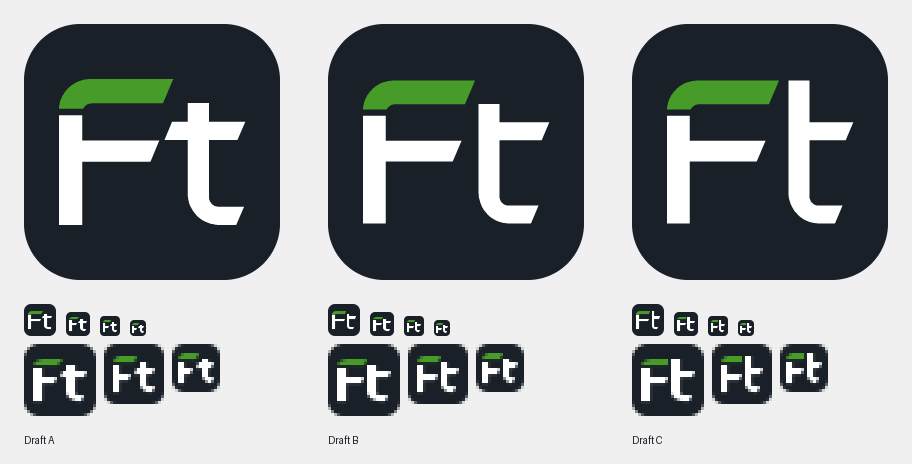

# 0004 – The router's skeleton: tray app, drop window, installer, tests

**Who:** worker · **Status:** waiting for the owner – icon choice and his PC test (everything else done, 20 Nov 2026) · **Lane:** Router
**Repository it changes:** `smholte/ToolBox` · **Branch:** `task/0004-router-skeleton`
**Started by:** lead, 18 Nov 2026 · **Model:** Opus · effort High · **Environment:** add `smholte/Fresing` (read only) · **Merge:** worker merges after a green GitHub run

## Goal

The owner installs "Fresing ToolBox" on his PC and sees its icon next to the clock, with a small drop window that
opens from it. It does nothing with a file yet. Everything later tasks need is in place: the app's frame, the
installer, the tests on GitHub (also on Windows), the texts in a language file, the icon.

## Background

- The plan: `docs/step-b-router.md` – read it first, with its "Decided by the owner".
- Electron, plain JavaScript, no build step beyond packaging. Windows only for users; development and most tests
  on Linux.
- Fresing Render's installer (`smholte/CAD-render-animation`, `installer/`, public) installs per user without
  admin rights and updates from GitHub Releases. Read how it does it; do not copy its code without its lead's OK
  (it is GPL-3.0-or-later, this repository is MIT) – the same behaviour with Electron's own tools is the aim.
- **The icon (decided by the owner, 18 Nov 2026): "Ft"** – the rule for every Fresing app mark is F + the app's
  lowercase initial. The F (stem and green swoosh) comes unchanged from the master outlines. The **t is drawn new to
  the word mark's construction**: stems 35, horizontal strokes 30, outer radius 52, inner radius 16, x-height 171
  (master units), free stroke ends cut at 22.8° from vertical; drawn beside the master r so the weight matches. White
  letters, Fresing Green `#479B29` swoosh, on the rounded Deep Charcoal `#1A2027` square of the Fresing app icon (same
  square, corner radius and padding); readable at 16 px. The specification and the logo files are in
  **`smholte/Fresing`**, `brand/Fresing-Brand-Specification.md` §4.6–4.7 and `brand/logo/` – read them there (that
  repository must be in this task's environment, read only). Once the owner approves the t, its outline goes into the
  report for the Fresing lead (the ToolBox lead sends it on).

## The work

1. **Repository layout** for the app (`app/` for its code, `tests/`, `tools/`, `brand/`), written into `CLAUDE.md`
   section 3 as a short table.
2. **The app's frame:** starts, shows a tray icon with a menu (Open drop window · Start with Windows ✓ · Language ·
   About with the version · Quit), one instance only (a second start brings up the first), a small drop window that
   accepts a dropped file and for now only shows its name and size.
3. **Texts:** every text the user sees comes from `app/lang/en.json`; a language setting in the tray menu that lists
   the language files present; a test that no text is written straight into the code and that every key is used.
4. **Icon drafts for the owner to choose from:** "Ft" with three drafts of the t (all within the construction
   above, e.g. different crossbar length or top), as SVG and as a picture in the report. After his choice: the `.ico` (16 to 256 px), the tray icon (16,
   20, 24, 32 px, drawn on whole pixels), PNGs for the page. **Stop for the owner here** ("WAITING FOR YOU:") with
   the picture; go on with a placeholder so the rest is not blocked.
5. **The installer:** per user, no admin rights, into the user's own app folder, with a Start-menu entry and an
   uninstaller that removes only what it installed. "Start with Windows" is on after install and follows the tray
   switch. Not signed; the installer's first screen and the README say what Windows will show and why.
6. **Tests on GitHub at every push:** on Linux the app's own tests (the frame started without a screen); on Windows
   a run that installs the app, starts it, checks the tray process and the autostart entry, uninstalls it and
   checks nothing is left. About 5 minutes; say in the report how long it takes.
7. **A release run** on GitHub that builds the installer from `main` and attaches it to a draft release (the owner
   publishes it). Updates from Releases are task 0008, not here.
8. **Steps for the owner**, click by click: download, the Windows warning, install, where the icon is, the menu,
   uninstall.

## Done when

- [ ] The installed app shows its tray icon on GitHub's Windows machine (the test) and on the owner's PC (his steps)
- [ ] One instance only; the drop window shows a dropped file's name and size; Quit really quits
- [ ] Start with Windows can be switched off and stays off after a restart of the app
- [ ] All texts come from `en.json`; the two text tests pass
- [ ] The owner has chosen the icon; the chosen icon is in the app, the installer and `brand/`
- [ ] Install and uninstall leave nothing behind on GitHub's Windows machine
- [ ] Windows-only code reviewed by a helper or chat that did not write it
- [ ] `CLAUDE.md` section 3 (layout) and a new section on tests are current; report below filled in

## Not in this task

Anything with the Toolbox folder, file types, the popup, routes, jobs (0005–0007); "Open with" in Explorer and
updates (0008); signing; macOS and Linux installers; the window with web tools (step A).

---

## Report (filled in by the chat that did the task)

**Chat / date:** worker chat (Claude Code on the web), 20 Nov 2026. Branch `task/0004-router-skeleton`.

**State: WAITING FOR THE OWNER** – the icon choice (A, B or C) and his test on his PC. Everything else is done and
green on GitHub. The app carries draft **A** as a placeholder until he chooses.

**What changed:**

- **The app** (`app/`, Electron 45.2.3, plain JavaScript, version 0.1.0): tray icon with the menu *Open drop window ·
  Start with Windows ✓ · Language · About Fresing ToolBox · Quit*; a left click opens the drop window. One instance
  only (a second start ends and brings up the first one's drop window). The drop window shows a dropped file's name
  and size (several files: the first and "and N more"; a folder: says so); closing it only hides it. Started by
  Windows at login (`--autostart`) it stays in the tray; started by hand it shows the drop window. Settings
  (`settings.json`: language, start with Windows) in the app's own folder `%APPDATA%\Fresing ToolBox`.
- **Texts:** every text the user sees is in `app/lang/en.json`, the installer's first screen too (written into
  `installer/texts.nsh` at build time). The Language submenu lists the language files present; a missing key falls
  back to English; numbers follow the language's `_locale`.
- **Start with Windows:** a value `nl.fresing.toolbox` in `HKCU\…\CurrentVersion\Run`. The installer writes it on a
  fresh install; once the app has run (it then has a settings file) the app alone owns it, so installing again over
  it keeps the user's choice. At a start the app changes it only when it differs from the setting, so it never
  undoes a switch-off in Task Manager. A development run (`electron .`) never registers itself.
- **Installer** (electron-builder 26.18.1, NSIS, `installer/installer.nsh`): for the current user only, never asks for
  administrator rights (no "for all users" page), into `%LOCALAPPDATA%\Programs\Fresing ToolBox`, Start-menu entry
  "Fresing ToolBox", no Desktop shortcut, runs the app at the end. First screen: what Windows showed before it
  ("Windows protected your PC") and why (not signed). The uninstaller removes the app, its Start-menu entry, its
  entry in Settings > Apps, the Run value (and a Task Manager note on it), the app's data folder and the copy of the
  installer electron-builder keeps for updates (`%LOCALAPPDATA%\fresing-toolbox-updater`, 115 MB). Installer size:
  115.6 MB.
- **Icon drafts** (`tools/make_icons.py`, `brand/`): three drafts of the t – see below. The script also makes the
  `.ico` for app, installer and shortcuts (16–256 px), the tray `.ico` (16, 20, 24, 32 px) and PNGs. 16, 20 and 24 px
  are set by hand on whole pixels (strokes 2 px, gaps 1 px); 32 px and up follow the outline.
- **Tests on GitHub at every push** (`.github/workflows/test.yml`): Linux – icons up to date, unit and text tests,
  the app started through Playwright under a virtual screen. Windows – unit and text tests, the installer built,
  installed, started, tested, installed again, uninstalled, checked (`tests/windows/install-test.ps1`).
- **Release run** (`.github/workflows/release.yml`, started by hand): builds the installer from `main` and puts it on
  a draft release `v<version>`, pinned to the built commit; the owner publishes it.
- `CLAUDE.md`: section 3 has the repository's layout; a new section 8 on tests ("Things learned" is now 9). README:
  the owner's install steps.

**The icon – three drafts of the t** (`brand/drafts/ft-drafts.png`, SVGs beside it): the F and its green swoosh are
the Fresing master outline unchanged; the t is new to the construction (stem 35, bars 30, radii 52/16, x-height 171,
stroke ends cut at 22.8°).

- **A** – crossbar on both sides of the stem, stem top level with the swoosh's lower edge. The most "t"-like.
- **B** – crossbar only to the right, like the F's own arm; same stem height as A. Closest to the r of Fresing
  Render's "Fr".
- **C** – the stem rises to the top of the swoosh (as tall as the F), crossbar to the right. Most distinct at 16 px.

**Note on the source of the F:** `smholte/Fresing` could not be added to this session (refused by the session's
safety check), so the brand specification §4.6–4.7 was not read. The F's outline was taken from the public Fresing
Render app mark (`site/brand/fresing-render/fresing-render-app-icon.svg` in `smholte/CAD-render-animation`, "from
Fresing logo rev 01"): its coordinates only, no code (that repository is GPL). Its square, corner radius 112/512,
side padding 70/512 and colours (#1A2027, #479B29, white) are kept; the t's measures match its r exactly (stem 35,
bar 30, radii 52/16, 22.8° cuts). The Fresing lead may want to check the drafts against §4.6–4.7.

**Tested and measured:**

- **This chat's Linux machine** (Node 22.23, Electron 45.2.3 under Xvfb): 17 tests pass – units (sizes, placeholders,
  languages, settings, installer texts, one name for the app), texts (no text in code or pages, every key used and
  present), and the app through Playwright (tray menu, drop window, one instance, Start with Windows off and still
  off after a restart, language switch kept after a restart, Quit). Breaking the single-instance lock on purpose
  made its test fail.
- **GitHub, Linux** (ubuntu-24.04): the same, about 40 s.
- **GitHub, Windows** (windows-2025, no visible desktop): the installed
  app makes its tray icon (install 14–33 s), the tray process runs, the Run value is on after install, a second start ends and the
  first shows its drop window, one process, the app tests pass against the installed app (registry checked), Quit
  leaves no process, installing again keeps "off", uninstall 3–4 s, and nothing is left: folders under
  `%LOCALAPPDATA%`, `%APPDATA%`, Start menu, Desktop, Startup, keys under `HKCU\Software`, `…\Uninstall`,
  `…\Classes`, notification settings, Run and StartupApproved values. All 36 checks pass. The whole Windows job takes
  **about 3 minutes** (npm install, building the installer ~1 min, the install test itself ~70 s).
- **Release run** on GitHub, from `main`: made the draft release **v0.1.0** with `Fresing-ToolBox-Setup-0.1.0.exe`
  (placeholder icon A). Running it again after the icon choice replaces the file in the same draft.
- After the merge one app test failed once on `main` (it checked the drop window before it had finished showing, on
  a slow first start); it now waits. `main` green again at `347b452`.
- **Not tested by a chat:** the welcome screen's look and the SmartScreen warning (a silent install shows no
  screens), whether the icon is visible next to the clock on a real desktop, dragging a real file from Explorer
  (the tests drop a file inside the page). These are the owner's steps.
- **Independent review** of the Windows-only code by a helper agent that did not write it: 2 bugs (a reinstall would
  switch Start with Windows back on; the installer's update copy was left behind), 5 risks, 2 notes – all fixed or
  answered in the last commit (one shared app id with a test; start never rewrites Task Manager's note; status-file
  race; uninstall waits for its last step; uninstall runs even when a check stops the script; draft release pinned
  to the built commit). `%LOCALAPPDATA%\Programs` is Windows' own folder and is left alone.

**Steps for the owner** (also in `README.md`, "Install Fresing ToolBox"):

1. Choose the icon: open `brand/drafts/ft-drafts.png` (in this file above) and tell the chat **A**, **B** or **C**.
2. After that the chosen icon goes in and the release run is started again (GitHub → **Actions** → **release** →
   **Run workflow**). Then: GitHub → smholte/ToolBox → **Releases** → the draft "Fresing ToolBox 0.1.0" → under
   **Assets** download **Fresing-ToolBox-Setup-0.1.0.exe**. (The draft already holds an installer with the
   placeholder icon A, if you want to try the app before choosing.)
3. Open it. **"Windows protected your PC"** appears: **More info** → **Run anyway**.
4. The first screen explains that warning: **Next** → **Install** → leave **Run Fresing ToolBox** ticked → **Finish**.
5. Next to the clock: a dark square with **Ft** (or under the **^** arrow). The drop window opens once by itself.
6. Drop a file from Explorer on the drop window: its name and size appear.
7. Right-click the icon: untick **Start with Windows**, **Quit**, start Fresing ToolBox from the Start menu, right-click
   again: still unticked. Tick it again. **About** shows "Fresing ToolBox 0.1.0".
8. Restart the PC: the icon is back next to the clock.
9. Settings → Apps → Installed apps → Fresing ToolBox → ⋯ → **Uninstall**: the icon, the Start-menu entry and the
   folder `C:\Users\<you>\AppData\Local\Programs\Fresing ToolBox` are gone.

**Open points / follow-up tasks:**

- **The owner's choice of t** (A/B/C). Then: set `CHOSEN` in `tools/make_icons.py`, run it (the `.ico`, tray icons and
  PNGs follow), push, and send the chosen outline (`brand/ft-app-icon.svg`) to the Fresing lead through the ToolBox
  lead.
- **The owner's test on his PC** (steps above), from a draft release made after the choice.
- The installer is 115 MB and electron-builder keeps a second copy of it for differential updates; task 0008
  (updates) decides whether that copy is wanted.
- The Windows run on GitHub has no visible desktop: "tray icon made" means Electron created it without error, not
  that a person saw it. The owner's step 5 is the real check.
- A user who disables ToolBox in Task Manager's Startup page still sees "Start with Windows ✓" in the menu
  (Electron reports the Run value, not that note); the app no longer undoes it. Could be shown in 0008.
- Test hooks in the app (`FRESING_TOOLBOX_DATA`, `_STATUS`, `_LANG_DIR`) do nothing unless set; 0009's review may
  want them behind a build switch.
